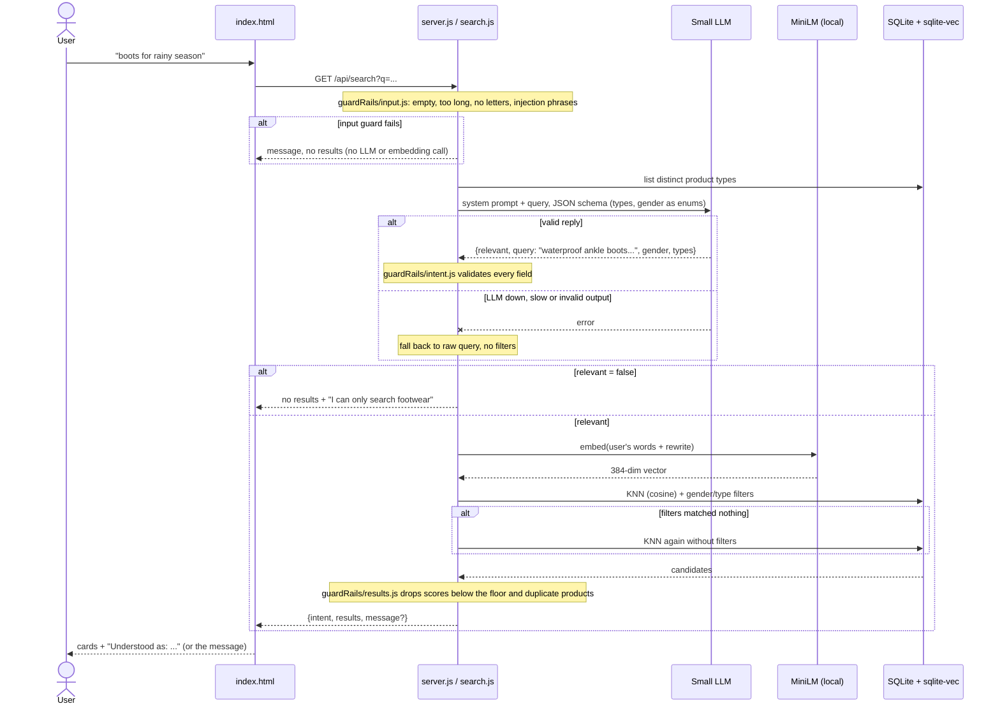
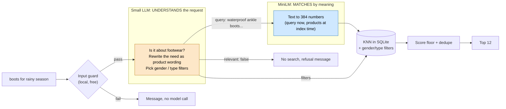
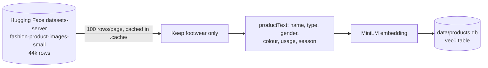

# AI product search

Natural-language search over ~5k footwear products: type **"boots for rainy season"**, get fitting products,
even when no product name contains those words.

A small LLM only *understands* the query. Ranking is vector search in a single committed SQLite file.
Guardrails keep the LLM from inventing things and keep off-topic queries from returning random results.

## The two models and their roles

| | **MiniLM** (embedding model) | **Small LLM** (chat model) |
|---|---|---|
| Model | `Xenova/all-MiniLM-L6-v2`, ~90 MB, runs in-process | Any OpenAI-compatible endpoint (LM Studio, Ollama), 3B instruct is enough |
| Role | **Finds** products by meaning | **Understands** the request |
| Turns | text into 384 numbers; similar meaning = close numbers | a sentence into `{relevant, query, gender, types}` |
| Used | offline for every product, and at search time for the query | at search time only, once per query |
| Why | "rainy season" appears in no product name; vectors still match it to boots | maps needs to footwear ("beach holiday" -> sandals), sets filters, rejects off-topic queries |
| Required? | **Yes**, there is no search without it | **No**, if it is down the search uses your raw words (no filters, no off-topic gate) |
| Never does | write text or filter | see products or rank them |

In short: **MiniLM does the matching, the LLM does the understanding.**

## Run

```bash
npm i
cp .env.example .env      # point it at your LLM endpoint
npm start                 # http://localhost:3000
npm test
```

`data/products.db` is committed, so there is no build step. To rebuild it (slow, see below): `npm run index`.

### Configuration (`.env`)

| Variable | Default | Meaning |
|---|---|---|
| `SEARCH_LLM_BASE_URL` | `http://localhost:1234/v1` | Any OpenAI-compatible endpoint (LM Studio, Ollama, ...) |
| `SEARCH_LLM_MODEL` | `local` | Model id as the server lists it |
| `SEARCH_LLM_API_KEY` | none | Sent as a Bearer token when set (LM Studio can require one) |
| `SEARCH_LLM_TIMEOUT_MS` | `30000` | Then the search falls back to the raw query |
| `SEARCH_MIN_SCORE` | `0.3` | Cosine score floor; weaker hits are dropped |

`.env` is git-ignored. A plain 3B instruct model is enough (e.g. Qwen2.5-3B-Instruct); a 9B reasoning model also
works (~1-2 s per search) but is more than this job needs.

## Request flow



## What each model does



| Step | Who | Output |
|---|---|---|
| Is this about footwear? Which gender / type? What does "rainy season" imply? | **Small LLM** | `{relevant, query, gender, types}` |
| Turn the (rewritten) query into a vector | **MiniLM** | 384 numbers |
| Find the closest product vectors | SQLite + sqlite-vec (no model) | candidate products |
| Drop weak and duplicate hits | guardRails/results.js (no model) | top 12 |

The LLM never sees the products and never ranks: it only decides whether the request is about footwear, rewrites it
into catalogue-like wording and picks optional filters, **only from values that really exist**.
MiniLM never reads the request as language to act on: it only turns text into vectors so that similar meanings land
close together. Neither model writes the results; the ranking is plain vector distance.

## Guardrails

| Risk | Guard |
|---|---|
| LLM returns junk or prose | `response_format` JSON schema (types and gender are enums); if the endpoint rejects it, retry without; `parseIntent` validates every field |
| LLM invents a shoe type or gender | Filtered against the real catalogue values |
| Empty, oversized, letterless or obvious injection input | `guardRails/input.js` runs first, locally; on failure **no LLM or embedding call is made** |
| Off-topic query that passes the input guard ("write a poem") | Prompt rules + `relevant` flag; no search runs, UI shows a message |
| Rewrite drifts from what was asked | Query embedded together with the user's own words |
| Random/weak results | Cosine score floor (`SEARCH_MIN_SCORE`) and duplicate products removed |
| LLM down or slow | Falls back to the raw query, UI says so |

## Index build (offline)



`MAX_PAGES=250 npm run index` limits the fetch (the committed DB was built that way: 5,236 products).
The API throttles; a failed run resumes from `.cache/`. Rebuilding overwrites the committed binary file.

## Files

| File | Role |
|---|---|
| [systemPrompts/queryParser.js](systemPrompts/queryParser.js) | The LLM's system prompt |
| [guardRails/input.js](guardRails/input.js) | Local input checks before any API call |
| [guardRails/intent.js](guardRails/intent.js) | JSON schema + validation of LLM output |
| [guardRails/results.js](guardRails/results.js) | Score floor, dedupe, refusal messages |
| [search.js](search.js) | Wiring: LLM call, embedding, KNN query, fallbacks |
| [server.js](server.js) | `/api/search` and the static page |
| [build-index.js](build-index.js) | dataset -> `data/products.db` |
| [index.html](index.html) | search box and cards |
| [PLAN.md](PLAN.md) | original plan and rejected options |

## Known limits

- The dataset has no waterproof/material field; "rainy" works through product names and the LLM's rewrite.
  Only ~9 products are real boots, so boot queries soon return casual shoes, and "boat" shoes can outrank
  real boots because the two words embed close together.
- Filters are all-or-nothing: if gender+type match nothing, both are dropped.
- Duplicates are removed by exact product name only.
- The input guard's injection check is a small phrase list; a reworded attack gets past it and is caught only by the LLM's `relevant` flag.
