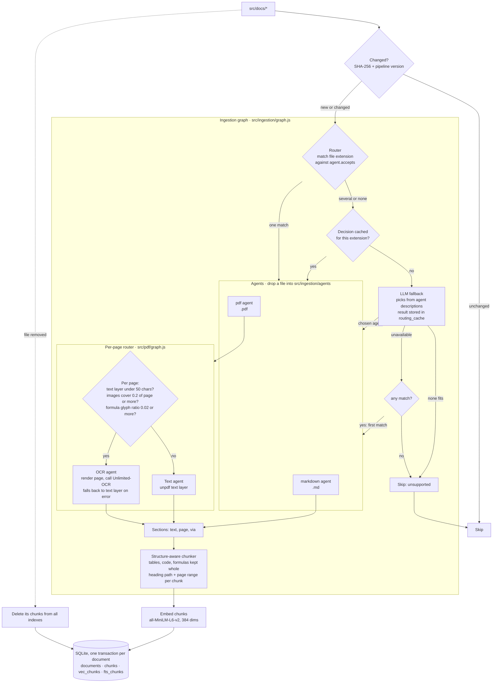
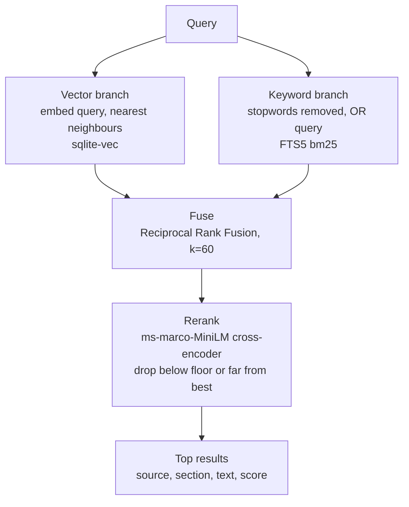

Referece Docs:
----

- [ai-langchain-langgraph-rag.md](https://gist.github.com/KiranMantha/aea0f556af1de0adb0ce0e594e4f586e)

# Flow

Two flows share one SQLite database (`src/docs.db`): **ingestion** writes it, **search** reads it.

## Ingestion (`pnpm ingest`)

A file that fails to parse (for example a password-protected PDF) is skipped and its existing chunks are kept.

The router's LLM is called only for files with several or no matching agents. Its decision is cached per extension in the `routing_cache` table (keyed on the candidate agents' names and descriptions, so editing an agent invalidates it), so an unrecognised extension costs one call, not one per file. Extensionless files are decided on content and never cached.

## Search (`search_docs` MCP tool)

The vector and keyword branches run in parallel (LangGraph, `src/rag.js`).

## Adding a format

Add a file to `src/ingestion/agents/` that default-exports `{ name, description, accepts, process(filePath) }`. It is discovered on the next run; nothing else needs editing. The contract is documented at the top of `agents/markdown.js`.

## Configuration

Settings live in `.env`, which is git-ignored. Create it with `cp .env.example .env`. The `start`, `ingest`, `ingest:full` and `test` scripts load it through `env-cmd`, and a variable already set in your shell takes precedence over the file. The scripts fail if `.env` is missing. `test:unit` doesn't use it.

| Variable | Used by | Default |
| --- | --- | --- |
| `DOCS_DIR`, `DB_PATH` | ingest, server | `src/docs`, `src/docs.db` |
| `OCR_BASE_URL`, `OCR_MODEL`, `OCR_PROMPT`, `OCR_API_KEY` | OCR agent | `http://localhost:8000/v1`, `baidu/Unlimited-OCR`, `document parsing.`, unset |
| `OCR_ENABLED` | OCR agent. `false` uses the text layer for every page | `true` |
| `OCR_TIMEOUT_MS` | OCR agent, per page | `300000` |
| `PDF_MIN_CHARS`, `PDF_MAX_IMAGE_COVERAGE`, `PDF_MAX_MATH_RATIO` | PDF router: a page goes to OCR when any threshold trips | `50`, `0.2`, `0.02` |
| `PDF_RENDER_SCALE` | OCR agent, page render scale | `2` |
| `ROUTER_BASE_URL`, `ROUTER_MODEL`, `ROUTER_API_KEY` | LLM fallback router (any OpenAI-compatible endpoint) | unset: fallback disabled |
| `ROUTER_TIMEOUT_MS` | LLM fallback router | `60000` |

## Commands

- `pnpm ingest` indexes new and changed files only. `pnpm ingest:full` rebuilds everything.
- `pnpm test:unit` runs the chunker and routing-cache tests. `pnpm test` runs the MCP client against the server.
