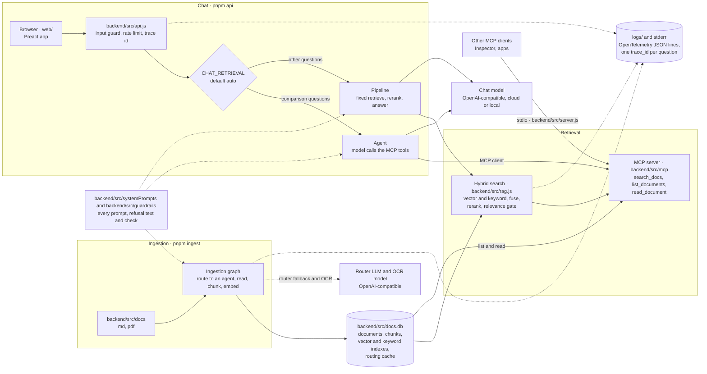
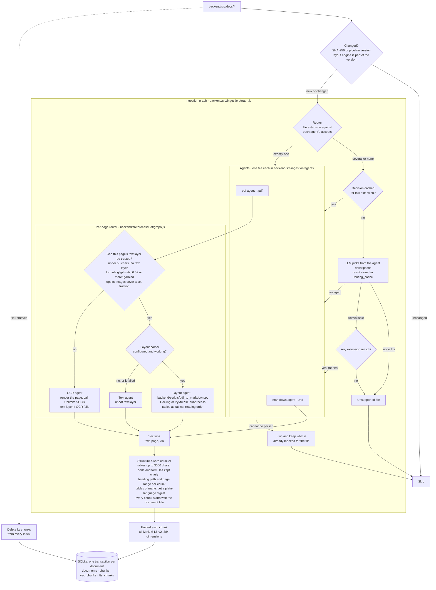
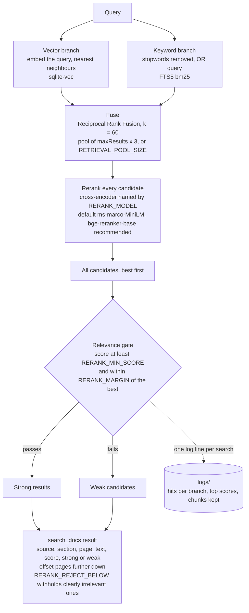
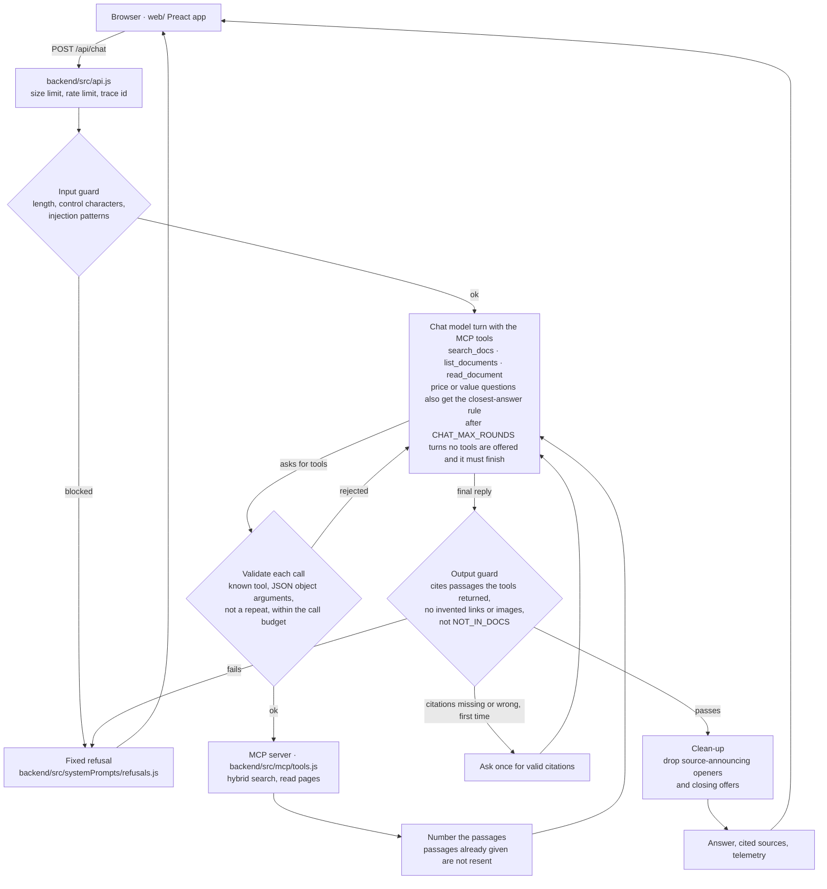
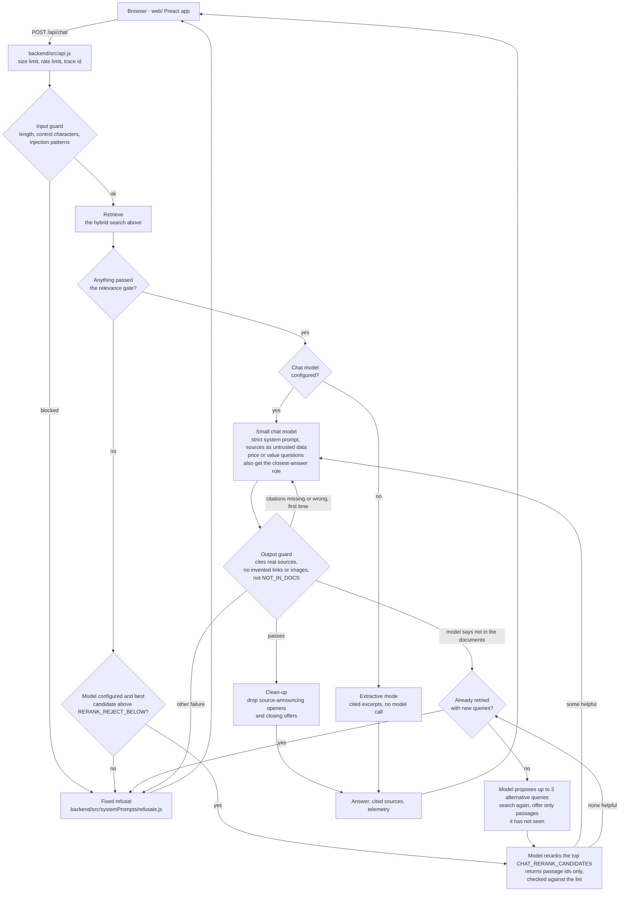
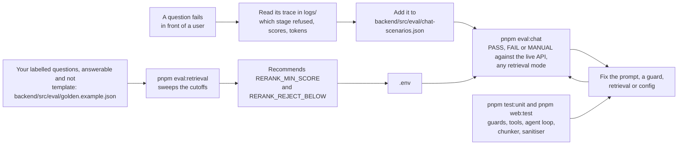

Referece Docs:
----

- [ai-langchain-langgraph-rag.md](https://gist.github.com/KiranMantha/aea0f556af1de0adb0ce0e594e4f586e)
- [SCALING.md](SCALING.md): known limitations and planned enhancements for larger corpora

# Project layout

```text
backend/        the RAG system: ingestion, search, MCP server, chat API (Node)
  src/            code, tests, the documents (src/docs) and the index (src/docs.db)
  scripts/        the PDF layout parser (Python, run as a subprocess)
  package.json    backend dependencies and scripts
web/            the chat frontend (Preact, Vite); talks to the API only over /api/chat
.env            settings for both, read by env-cmd (git-ignored; template: .env.example)
logs/           structured logs, one timestamped file per process start (git-ignored)
package.json    forwards pnpm ingest, api, dev, eval:chat ... to backend/ and web/
```

Install once with `pnpm backend:install` and `pnpm web:install`. Every command below runs from this folder.

# Flow

How the pieces fit. Everything reads and writes one SQLite database (`backend/src/docs.db`).



Each part is described below.

## Ingestion (`pnpm ingest`)



A file that fails to parse (for example a password-protected PDF) is skipped and its existing chunks are kept.

The router's LLM is called only for files with several or no matching agents. Its decision is cached per extension in the `routing_cache` table (keyed on the candidate agents' names and descriptions, so editing an agent invalidates it), so an unrecognised extension costs one call, not one per file. Extensionless files are decided on content and never cached.

## Search (`search_docs` MCP tool)



The vector and keyword branches run in parallel (LangGraph, `backend/src/rag.js`). The fixed chat pipeline uses only the strong results at first; `search_docs` returns both so a model can judge weak matches itself.

## Chat (`pnpm api` + `web/`)

A Preact app in `web/` talks to a small HTTP API (`backend/src/api.js`) that answers from the indexed documents with a chat model and refuses anything they don't support. There are three ways to retrieve, chosen by `CHAT_RETRIEVAL`:

- **`auto` (default when a chat model is configured):** comparison questions ("compare", "versus", "which is better", "difference") go to the agent, everything else to the cheaper fixed pipeline.
- **`agent`: model-driven retrieval.** The chat model is an MCP client of this project's own docs server (`backend/src/mcp/tools.js`). It decides which tools to call, can search again with different wording, can read around a hit, and answers from what the tools return.
- **`pipeline`:** a fixed retrieve, rerank, answer flow (described further down), cheaper per question.
- With no chat model configured the API runs in **extractive** mode and returns cited excerpts.

Why `auto`: measured on the first 10 scenarios with a local 9B reasoning model, the pipeline passed 10 of 10 using about 19k tokens and the agent 9 of 10 using about 52k (14 to 68 seconds a question against 6 to 27). But the pipeline's weak spot is comparisons: one search returns mostly one document and the answer says the other has no data, while the agent searches each side. So comparisons use the agent and lookups the pipeline. The current 14 scenarios in `auto` mode pass 13 of 14 (about 58k tokens in all); the exception is scenario 05, see "Price, value and which-is-better questions" below. A stronger tool-calling model may do better, so re-run `pnpm eval:chat` with each mode (`CHAT_RETRIEVAL=auto|pipeline|agent`) before choosing.

### Model-driven retrieval (`agent`)



The MCP server exposes three read-only tools. The same server runs standalone over stdio (`pnpm start` opens the MCP Inspector on it), so any MCP client can use the documents, not only this chat.

| Tool | What it does |
| --- | --- |
| `search_docs(query, maxResults?, offset?)` | Hybrid search. Returns passages marked `strong` (passed the relevance gate) or `weak`, with scores; `offset` pages further down the ranking |
| `list_documents()` | What is indexed: documents, passage counts, page ranges |
| `read_document(doc, page?)` | The passages of one document in order, optionally one page (capped), for tables and lists that continue across passages |

The model chooses the arguments, so nothing it sends is trusted: the tool must exist, arguments must be a JSON object, an identical repeat is not run again, and a turn has a budget of model rounds and tool calls (`CHAT_MAX_ROUNDS`, `CHAT_MAX_TOOL_CALLS`). When the budget is used up the model gets no tools and must finish. Passages get a number the first time they appear in a turn and keep it, so a citation `[3]` can be checked against what the tools really returned.

### Fixed pipeline (`pipeline`, and lookups in `auto`)



How "only from the ingested data" is enforced:

- **No evidence, no answer.** If search returns nothing relevant, the reply is a fixed refusal.
- **Cheap gate first, model second.** The cross-encoder gate accepts clear matches with no extra cost. When it rejects everything but the best candidate is not obviously irrelevant (above `RERANK_REJECT_BELOW`), a model reads the top `CHAT_RERANK_CANDIDATES` passages and returns the ids that help, which fixes questions the small reranker mis-scores (for example a yes/no question about one item in a feature list). The model returns integers only, checked against the offered list, so text inside a document cannot be echoed or obeyed. Clearly irrelevant questions below the floor skip the model. This costs one extra model call only for uncertain questions.
- **One retry with different words.** Documents often say "trims" where users say "variants". When the model finds nothing helpful, or the answer model says the sources don't cover it, the model proposes up to three alternative search queries, the search runs again, and only passages it has not already seen are offered. It happens once per question (`CHAT_QUERY_REWRITE=false` turns it off) and costs extra model calls only for questions that would otherwise be refused.
- **Strict system prompt** (`backend/src/systemPrompts/`, versioned as `PROMPT_VERSION`). The model sees only the retrieved sources, treats them as untrusted data, must cite every claim as `[n]`, and must reply `NOT_IN_DOCS` when the sources don't cover the question or the request is off-topic. The prompt has an output contract with WRONG/RIGHT examples, because small models drift from plain rules.
- **Output check** (`backend/src/guardrails/`). The answer is rejected unless it cites sources that exist and contains no link that isn't in the sources and no image. Refusals are recognised wherever they appear: the `NOT_IN_DOCS` marker anywhere in the reply, a refusal opener ("I cannot answer..."), or a first sentence saying the sources do not state it. Source-announcing openers and closing offers are then stripped deterministically.
- **Telemetry on every response.** `enforcementLayer` says which layer refused (`input_guard`, `relevance_gate`, `llm_rerank`, `model_refusal`, `output_guard`, `llm_error`), and `usage` lists each model call with its latency and prompt, completion and cached tokens. The API logs a summary line per question.
- **Input check.** Length and control characters are checked, and obvious injection phrases are blocked. This is a heuristic, not a security boundary; the output check is the real defence.
- **Safe rendering.** The frontend sanitises the model's markdown (no images, scripts or event handlers; links limited to http(s)).

### Price, value and which-is-better questions

Brochures and manuals rarely state a price, value for money or a recommendation. A question asking for one is recognised from its wording alone (no model call), and only then the prompts gain a closest-answer rule: the first sentence says plainly what the documents do not contain, then the answer compares what they do state about the items asked about (equipment, features, specifications) and says which lists more, labelled as a comparison of listed equipment. It must never state or imply the missing information, and the output guard accepts such an opening sentence only when a cited comparison follows it. Every other question keeps the strict rule: an answer that opens by saying the sources do not state it is treated as a refusal and retried. Known gap: in the agent, the question "is seltos better or duster in 18lakh bracket" (scenario 05) still ends in a refusal.

Run it:

```bash
pnpm backend:install                 # once: backend dependencies
pnpm web:install                     # once: frontend dependencies
pnpm ingest                          # index documents
pnpm dev                             # API on :3001 and the frontend on http://localhost:5173 (hot reload, /api proxied)
```

To serve a production build from the API alone, run `pnpm web:build` then `pnpm api` and open http://localhost:3001.

Set `CHAT_BASE_URL` and `CHAT_MODEL` (and `CHAT_API_KEY` if the server needs one) in `.env` to use a chat model: any OpenAI-compatible endpoint, such as a cloud provider or a local LM Studio server. Reasoning models are supported: `<think>` blocks are stripped and never shown. Without these settings the API runs in extractive mode and returns the matching passages with sources.

## How it is tested and tuned



## Chat regression suite

Every question that ever failed in front of a user belongs in `backend/src/eval/chat-scenarios.json` as a scenario with expectations (status, reason, enforcement layer, patterns the answer must or must not match, phrases the cited evidence must contain). With the API running:

```bash
pnpm eval:chat            # PASS / FAIL / MANUAL per scenario, exit code 1 on any FAIL
```

Set `CHAT_TEMPERATURE=0` for repeatable runs. The checks are deliberately lenient (patterns, not exact text), so a PASS means "not broken", not "correct": read the answers for anything that matters.

## Calibrating the relevance gate

Search drops weak matches (and the chatbot refuses when nothing is left) using a reranker score cutoff, `RERANK_MIN_SCORE`. The right value depends on your corpus and the questions people ask, so it is a setting, not a constant, and it should not be tuned by eyeballing a few documents. Calibrate it against a labelled question set:

1. Write a golden set of real questions, including ones the documents cannot answer (see `backend/src/eval/golden.example.json`):
   `{ "query": "...", "answerable": true, "expectedPhrases": ["five business days"] }`
   `expectedPhrases` are phrases the retrieved evidence must contain, so a hit means the chunk that actually answers the question was found. (`expectedDocs` only checks the document, which any chunk of it satisfies.)
2. Run `pnpm eval:retrieval path/to/golden.json`. It shows, for each cutoff, how many answerable questions are still answered and how many unanswerable ones are rejected, lists the questions the current setting gets wrong, and suggests the highest cutoff that keeps at least 95% of answerable questions (`--target` changes this).
3. Set `RERANK_MIN_SCORE` in `.env`, and check it on questions you did not tune on. Re-run when the corpus or the questions change.

The default (`0`) is strict on purpose: until you calibrate, the system prefers "nothing found" over a weak match. The tool warns when a class has fewer than 30 questions.

## PDF layout parsing (optional, recommended)

A PDF's plain text layer comes out in drawing order, not reading order: a spec table's cells arrive scrambled and multi-column bullet lists are interleaved, so neither search nor the chat model can read them. A layout-aware parser converts each page to Markdown with real tables, headings and column order instead.

```bash
pnpm layout:setup     # once: a Python 3.12 environment in backend/.venv-layout with Docling (needs uv)
# then in .env:
#   PDF_LAYOUT_ENGINE=docling
#   PDF_LAYOUT_PYTHON=.venv-layout/bin/python   (relative to backend/)
pnpm ingest           # changing the engine re-reads every PDF
```

The parser runs as a subprocess of `backend/scripts/pdf_to_markdown.py` (no shell, with a timeout), and if it is missing or fails the pipeline falls back to the plain text layer. Scanned pages with no text still go to the OCR agent, so Docling's own OCR is switched off (it is what makes it take minutes a page).

| Engine | Licence | Measured here (11-page brochure, Apple silicon CPU) |
| --- | --- | --- |
| `docling` (recommended) | MIT | about 11 s for the whole document; best reading order and headings |
| `pymupdf` | AGPL | about 2 s for a dense page; recovers tables, bullet lists stay interleaved |
| none (default) | | plain text layer: tables scrambled |

On the Seltos brochure, the question "how many variants does the Seltos have?" failed with the plain text layer ("not stated") and is answered correctly (11 trims, listed) with the layout parser. Hosted parsers such as LlamaParse do the same job as a paid cloud API; the documents leave your machine, so that is a data-governance decision. Tables are kept whole in one chunk up to `CHUNK_MAX_TABLE_CHARS` (default 3000), because split across chunks the rows lose their column headers. A table of marks (rows by columns, cells just a bullet or a dash) is nearly all symbols, so the chunker appends a plain-language digest generated from its own cells (the column count and, per row, the columns marked). Every chunk also starts with its document's title (taken from the file name), so a question naming the subject can match a chunk that never repeats it. With the digest, the title and the `bge-reranker-base` cross-encoder, the variants and 7DCT table questions pass on the two-brochure index (13 of 13), where MiniLM alone failed both.

## Adding a format

Add a file to `backend/src/ingestion/agents/` that default-exports `{ name, description, accepts, process(filePath) }`. It is discovered on the next run; nothing else needs editing. The contract is documented at the top of `agents/markdown.js`.

## Logging

Every part of the system writes structured logs in the shape CNCF tooling expects: one JSON object per line, with the field names of the OpenTelemetry log data model (`timestamp`, `severity_text`, `severity_number`, `body`, `attributes`, `resource`, `scope`, `trace_id`, `span_id`). Lines go to stderr (stdout belongs to the MCP protocol), so a container runtime or collector can ship them as they are, and to a file in the root `logs/` folder (git-ignored). Each process start gets its own file, named with its start time: `logs/docs-rag-api-2026-10-26T12-03-55-768Z.log`, `docs-rag-ingest-...`, `docs-rag-mcp-...`.

`body` is a stable event name, never a sentence, so logs can be filtered by event; details are in `attributes`. Every line written while a question is answered shares one `trace_id`, which the API also returns in the `x-trace-id` header; an incoming W3C `traceparent` header is continued. An ingestion run shares one `trace_id` across its documents.

| Area | Events |
| --- | --- |
| Ingestion | `run.start`, `route` (agent and how it was chosen: extension, cache, llm, fallback), `pdf.layout_parsed` / `pdf.layout_fallback`, `pdf.parsed` (pages per route), `agent.done`, `chunked`, `document.indexed` / `document.skipped` / `document.removed`, `run.done` |
| Ask | `chat.request` (lengths and mode only), `stage.done` per step (guard_input, retrieve, adjudicate, rewrite, compose, verify, or agent_turn and tools) |
| Retrieval | `search`: vector and keyword hits, reranked count, top scores, chunks kept, gate settings, rerank model, duration |
| Model calls | `llm call`: model, kind, prompt, completion and cached tokens, duration; `tool.call` for each tool the agent runs |
| Response | `chat.response`: status, refusal reason and layer, sources cited, answer length, calls and tokens, duration |

Question and answer text is never logged, only lengths, counts, scores and timings. `LOG_QUERIES=true` opts in to the search query text for debugging. Errors carry the OpenTelemetry `exception.*` attributes. `LOG_LEVEL=debug` adds per-page PDF routing. `LOG_FORMAT=pretty` prints readable console lines while the file stays JSON.

## Configuration

Settings live in `.env`, which is git-ignored. Create it with `cp .env.example .env`. The `start`, `ingest`, `ingest:full` and `test` scripts load it through `env-cmd`, and a variable already set in your shell takes precedence over the file. The scripts fail if `.env` is missing. `test:unit` doesn't use it.

| Variable | Used by | Default |
| --- | --- | --- |
| `DOCS_DIR`, `DB_PATH` | ingest, server | `backend/src/docs`, `backend/src/docs.db` |
| `OCR_BASE_URL`, `OCR_MODEL`, `OCR_PROMPT`, `OCR_API_KEY` | OCR agent | `http://localhost:8000/v1`, `baidu/Unlimited-OCR`, `document parsing.`, unset |
| `OCR_ENABLED` | OCR agent. `false` uses the text layer for every page | `true` |
| `OCR_TIMEOUT_MS` | OCR agent, per page | `300000` |
| `PDF_MIN_CHARS`, `PDF_MAX_MATH_RATIO` | PDF router: a page goes to OCR when its text layer is missing or garbled | `50`, `0.02` |
| `PDF_OCR_IMAGE_COVERAGE` | PDF router, opt-in: also OCR pages where images cover at least this fraction. Leave unset unless the corpus has text inside images | unset |
| `RERANK_MODEL` | Cross-encoder used to rerank. The scale differs per model, so re-run `pnpm eval:retrieval` after changing it | `Xenova/ms-marco-MiniLM-L-6-v2` |
| `RERANK_MIN_SCORE`, `RERANK_MARGIN` | Search relevance gate. Calibrate with `pnpm eval:retrieval` | `0`, `3` |
| `CHAT_RETRIEVAL`, `CHAT_MAX_ROUNDS`, `CHAT_MAX_TOOL_CALLS` | Chat: `auto` (comparisons use the agent, the rest the pipeline), `agent` (model calls the MCP tools) or `pipeline`; agent budgets per question | `auto`, `5`, `6` |
| `CHAT_QUERY_REWRITE` | Chat: retry once with alternative search queries when nothing helpful was found | `true` |
| `RERANK_REJECT_BELOW`, `CHAT_RERANK_CANDIDATES` | Chat second-stage rerank: skip the model when the best score is below this floor, and how many top candidates it reads. Calibrate the floor with `pnpm eval:retrieval --target 0.99` | no floor (model reads every rejected question), `8` |
| `PDF_LAYOUT_ENGINE`, `PDF_LAYOUT_PYTHON`, `PDF_LAYOUT_TIMEOUT_MS` | Layout-aware PDF parser: `docling` or `pymupdf`, the Python that runs it, per-PDF timeout. Unset engine = plain text layer | unset, `python3`, `600000` |
| `LOG_LEVEL`, `LOG_DIR`, `LOG_STDERR`, `LOG_FORMAT`, `LOG_QUERIES` | Logging: level, folder (empty = no file), stderr on/off, `json` or `pretty`, include query text | `info`, `logs/`, `true`, `json`, `false` |
| `CHUNK_MAX_TABLE_CHARS` | Tables stay in one chunk up to this size | `3000` |
| `PDF_RENDER_SCALE` | OCR agent, page render scale | `2` |
| `ROUTER_BASE_URL`, `ROUTER_MODEL`, `ROUTER_API_KEY` | LLM fallback router (any OpenAI-compatible endpoint) | unset: fallback disabled |
| `ROUTER_TIMEOUT_MS` | LLM fallback router | `60000` |
| `API_PORT`, `CHAT_RATE_LIMIT_PER_MIN`, `CHAT_MAX_SOURCES` | Chat API | `3001`, `30`, `5` |
| `CHAT_BASE_URL`, `CHAT_MODEL`, `CHAT_API_KEY` | Chat model (any OpenAI-compatible endpoint) | unset: extractive mode |
| `CHAT_TIMEOUT_MS`, `CHAT_TEMPERATURE`, `CHAT_MAX_TOKENS` | Chat model. Temperature and max tokens are only sent when set, because some small models reject them | `60000`, unset, unset |

## Commands

- `pnpm layout:setup` creates the Python environment for the layout parser.
- `pnpm ingest` indexes new and changed files only. `pnpm ingest:full` rebuilds everything.
- `pnpm test:unit` runs the backend tests (chunker, routing cache, chat guardrails and graph). `pnpm web:test` runs the frontend sanitiser tests.
- `pnpm dev` runs the chat API and the frontend dev server together. `pnpm api` runs the API alone; `pnpm web:install`, `pnpm web:build` and `pnpm web:dev` manage the frontend.
- `pnpm test` runs the MCP client against the server.
- `pnpm eval:chat` runs the chat regression scenarios against the running API.
- `pnpm eval:retrieval <golden.json>` calibrates the relevance gate (see above).
- `pnpm router:check <file>` asks the configured router LLM which agent should read a file, to verify the endpoint, token and model.
